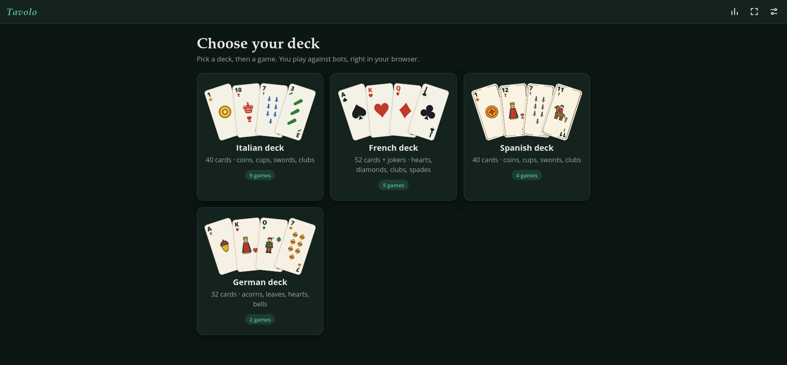
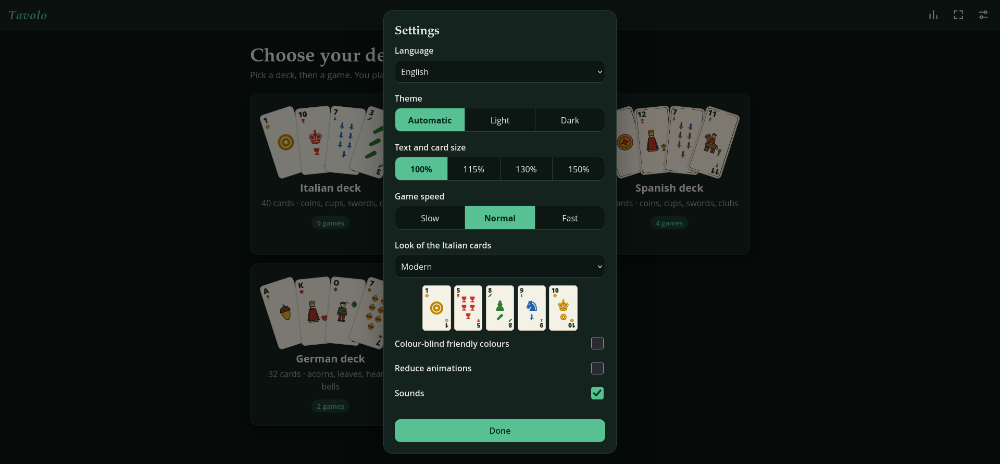
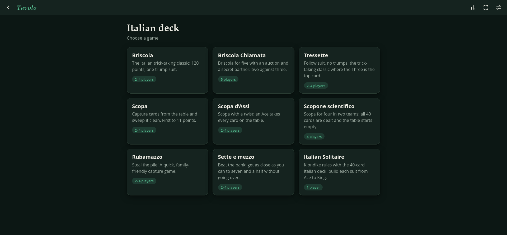
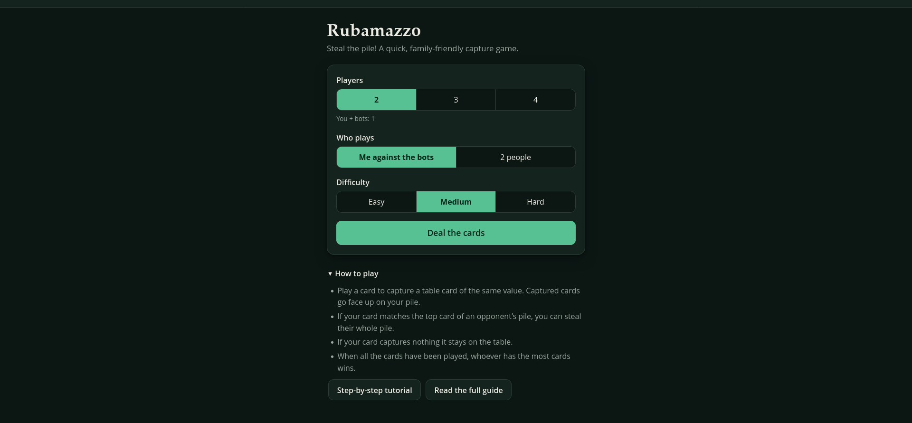
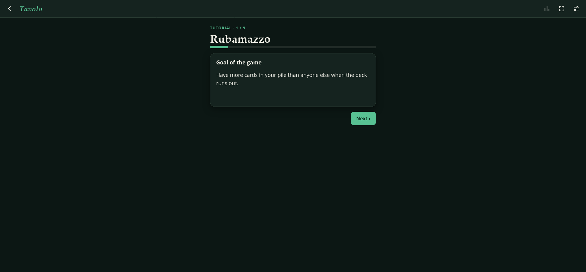
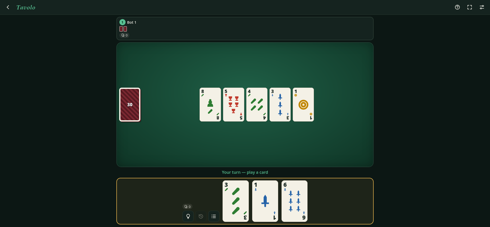

<div align="center">

# 🃏 Tavolo

[](https://app.codacy.com/gh/R0mb0/Tavolo/dashboard?utm_source=gh&utm_medium=referral&utm_content=&utm_campaign=Badge_grade)
[](https://github.com/R0mb0/Tavolo/actions/workflows/pages/pages-build-deployment)
[](https://github.com/R0mb0/Tavolo)
[](https://github.com/R0mb0/Tavolo)
[](https://opensource.org/license/mit)
[](http://paypal.me/R0mb0)

A free collection of classic card games that runs entirely in the browser. Pick a deck (Italian, French, Spanish or German), pick a game, choose the bots and play: 20 games, 9 languages, offline-ready, installable, with a guide and a tutorial for every game. No account, no ads, no server: everything stays on your device.

<div align="center">
  <a href="http://paypal.me/R0mb0">
    <picture>
      <source media="(prefers-color-scheme: dark)" srcset="https://github.com/R0mb0/Support_the_dev_badge/blob/main/Badge/SVG/Support_the_dev_badge_Dark.svg">
      <source media="(prefers-color-scheme: light)" srcset="https://github.com/R0mb0/Support_the_dev_badge/blob/main/Badge/SVG/Support_the_dev_badge_Light.svg">
      
    </picture>
  </a>
</div>

## [👉 Click here to play! 👈](https://r0mb0.github.io/Tavolo/)

[](https://r0mb0.github.io/Tavolo/)
[](https://r0mb0.github.io/Tavolo/)
[](https://r0mb0.github.io/Tavolo/)
[](https://r0mb0.github.io/Tavolo/)
[](https://r0mb0.github.io/Tavolo/)
[](https://r0mb0.github.io/Tavolo/)

</div>

---

## ✨ Features

- 20 classic card games on four decks, all on the same table with the same controls
- Bots with three difficulty levels (easy, medium, hard), 2 to 5 players depending on the game, team play where the game calls for it
- **Several people on one device**: from one person against the bots up to the whole table; the device is passed at each turn and hands stay face down in between
- A **"How to play" guide** for every game, with illustrated examples and the exact house rules used by the app
- A **step-by-step tutorial** for every game, ending with a practice game where the suggested move is always shown
- Hint button, game log, review of the last trick or capture
- **Pick up where you left off**: an interrupted game survives closing or reloading the page and resumes exactly as it was
- **Statistics** per game and per difficulty, a chart of the last two weeks, 12 achievements to collect, export/import as a file
- **9 languages**, detected automatically and switchable by hand: English, Italiano, Español, Français, Deutsch, Português, 中文, 日本語, 한국어
- Automatic light/dark theme (or chosen by hand)
- **Accessibility**: colour-blind friendly palette, zoom from 100% to 150%, reduced-motion option, checked contrast, fully playable with the keyboard, screen-reader labels on every card
- Four looks for the Italian deck: modern, Neapolitan, Piacentine and Sicilian
- Card animations, optional sounds, adjustable game speed
- **Installable PWA** with install and full-screen buttons; once opened, it works offline
- Touch, mouse and keyboard; phone, tablet and desktop
- Pure front-end: plain HTML, CSS and JavaScript, no build step, no dependencies (ideal for GitHub Pages)

---

## 🎴 The games

| Deck | Game | Players | In short |
|------|------|:-------:|----------|
| 🇮🇹 Italian (40 cards) | **Briscola** | 2–4 | The trick-taking classic: 120 points, one trump suit |
| | **Briscola chiamata** | 5 | Auction and secret partner: two against three |
| | **Tressette** | 2–4 | Follow suit, no trumps: the Three is the top card |
| | **Scopa** | 2–4 | Capture cards from the table and sweep it clean |
| | **Scopa d'assi** | 2–4 | Scopa with a twist: an Ace takes the whole table |
| | **Scopone scientifico** | 4 | Scopa in two teams, all 40 cards dealt |
| | **Rubamazzo** | 2–4 | Steal the pile! Quick and family-friendly |
| | **Sette e mezzo** | 2–4 | Beat the bank without going over seven and a half |
| | **Solitario** | 1 | Klondike rules with the Italian deck |
| 🇫🇷 French (52 cards) | **Scala 40** | 2–4 | The Italian rummy: open with 40 points |
| | **Burraco** | 2, 4 | Team rummy with two pots and burracos |
| | **Machiavelli** | 2–4 | Rummy where you can rebuild the whole table |
| | **Danish** | 2–4 | Play equal or higher, burn the pile with a 10 |
| | **Klondike** | 1 | The classic patience |
| 🇪🇸 Spanish (40 cards) | **Brisca** | 2–4 | The Spanish cousin of Briscola |
| | **Escoba** | 2–4 | Capture cards that add up to fifteen |
| | **Tute** | 2, 4 | Follow suit, beat the trick, sing your pairs |
| | **Chinchón** | 2–4 | Rummy played in the hand: close first |
| 🇩🇪 German (32 cards) | **Mau-Mau** | 2–4 | Be the first to get rid of all your cards |
| | **Schnapsen** | 2 | The Austrian duel with twenty cards: reach 66 |

---

## 🧠 Concept

Many people know these games from family tables, but every region (sometimes every family) plays them a little differently, and finding someone to play with is not always easy.

Tavolo puts them all in one place:
- **One table for every game**: the same flow everywhere (deck → game → options → play), so once you know one game you know how to use them all.
- **Rules you can read**: each game states the exact variant it uses in its guide, so nobody has to argue about house rules.
- **Learn by playing**: the tutorial walks through a real hand, then a practice game shows the suggested move at every turn.
- **Your data stays with you**: games, statistics and settings are saved only in your browser.

---

## 🚀 Getting Started

1. Open [the page](https://r0mb0.github.io/Tavolo/) (or install it with the install button).
2. Choose a deck.
3. Choose a game (each card on the screen tells you how many players it takes).
4. Set the options: number of players, who plays (you alone or several people), bot difficulty, length of the match.
5. Press Play! Use the ❓ button at any time to open the guide of the game.

### Run it locally

Opening `index.html` directly from disk does not work (browsers block `fetch` and service workers on `file://`), so serve the `docs` folder:

```bash
cd docs
python3 -m http.server 8000
# open http://localhost:8000
```

### Publish on GitHub Pages

Repository **Settings → Pages → Build and deployment → Deploy from a branch**, branch `main`, folder **`/docs`**.
When you publish a new version, bump `VERSION` in `docs/sw.js` so installed copies pick up the update.

---

## 👥 Playing on one device

In **"Who plays"** you choose how many people sit at the table; the remaining seats are bots.

- With one person, your hand is always face up.
- With several people, before each human turn a curtain asks the next player to take the device ("Player 2, it is your turn" → "I am ready"): cards stay face down until that person says they are ready.
- Games played by several people are not counted in the statistics.

---

## ⚙️ How a game is defined

Every game is a JSON file in `docs/games/` interpreted by a small rule engine. The file names an **engine** (a family of rules) and gives it every parameter: deck, players, teams, deal, card order, card points, capture rules, scoring, plus its own texts in each language (`name`, `tagline`, `rules`, `goal`, `tips`) and the illustrated examples of its guide.

```jsonc
{
  "id": "briscola",
  "deck": "italian",
  "engine": "trick",
  "players": { "options": [2, 3, 4], "default": 2, "teamsAt": [4] },
  "difficulty": ["easy", "medium", "hard"],
  "setup": { "handSize": 3, "removeForPlayers": { "3": ["2-coppe"] } },
  "rules": {
    "followSuit": false,
    "rankOrder": [1, 3, 10, 9, 8, 7, 6, 5, 4, 2],
    "cardPoints": { "1": 11, "3": 10, "10": 4, "9": 3, "8": 2 }
  },
  "i18n": { "en": { "name": "Briscola", "tagline": "…", "rules": ["…"] } }
}
```

| Engine | Family | Games |
|--------|--------|-------|
| `trick` | trick-taking, with or without trump, pairs and declarations | Briscola, Tressette, Brisca, Tute, Schnapsen |
| `called` | five-player trick-taking with auction and secret partner | Briscola chiamata |
| `fishing` | capture cards from the table | Scopa, Scopa d'assi, Scopone scientifico, Rubamazzo, Escoba |
| `banking` | hit or stand against the bank | Sette e mezzo |
| `patience` | columns, foundations, stock (one player) | Solitario, Klondike |
| `rummy` | sets and runs, jokers, opening score, laying off | Scala 40 |
| `burraco` | team rummy with wild cards, pots and burraco bonuses | Burraco |
| `machiavelli` | rummy with free rearranging of the table | Machiavelli |
| `chinchon` | rummy played in the hand, closing with few points left | Chinchón |
| `shedding` | play equal or higher, get rid of your cards | Danish |
| `maumau` | match suit or rank, special cards | Mau-Mau |

**Adding a variant** of an existing family needs only a new JSON file:
1. create `docs/games/<id>.json`;
2. add the id to the right deck in `docs/games/index.json`;
3. add the file to the `ASSETS` list in `docs/sw.js`.

**Adding a new family** needs a new engine in `docs/js/engines/` exposing the same small interface (`play`, `advance`, `view`, `botMove`, `result`), registered in `engines/index.js`.

---

## 🗂️ Project layout

```
docs/                 the whole web app (GitHub Pages root)
  index.html
  manifest.webmanifest, sw.js     PWA and offline cache
  css/style.css                   themes, cards, table
  js/app.js                       screens, settings, statistics, install / full screen
  js/table.js                     the shared game table and turn loop
  js/rummy.js                     the table for Scala 40, Burraco and Chinchón
  js/machiavelli.js               the table for Machiavelli
  js/banking.js                   the table for Sette e mezzo
  js/solitaire.js                 the table for patience games
  js/session.js                   saved game: seeded shuffle + list of moves, replayed on resume
  js/log.js, js/learn.js          game log, step-by-step tutorial
  js/achievements.js              achievements, worked out from the statistics
  js/cards.js                     decks and card drawing
  js/manual.js                    the "How to play" guide
  js/engines/                     rule engines
  js/i18n.js, js/store.js, js/ui.js, js/sfx.js
  games/index.json                decks and the games listed under each
  games/<game>.json               one file per game
  locales/<lang>.json             interface strings (generated)
tools/build-locales.mjs           translation table → docs/locales/*.json
tests/                            automated tests (node --test)
```

---

## 🧪 Tests

```bash
npm test
```

No dependencies are installed: the tests use Node's built-in runner (Node 20 or later). They play every game to the end with bots in every seat, check that a saved game resumes exactly as it was, and verify that game files, translations and the offline file list are complete. GitHub Actions runs them on every push and pull request.

---

## 🌍 Translations

- Interface strings live in one table, `tools/build-locales.mjs`: edit it and run `node tools/build-locales.mjs`.
- Game names, rules and tips are translated inside each game file.
- Corrections from native speakers are very welcome!

---

## 🎨 Card artwork

All card faces are drawn by the app itself (original SVG shapes and text glyphs): no third-party card images are used. The regional looks of the Italian deck are original drawings in the spirit of the traditional patterns.

---

## 🔒 Privacy

- No account, no tracking, no ads, no server-side code.
- Saved games, statistics and settings live only in the browser (`localStorage`); clearing the site data deletes them.
- Use the export button in the statistics to keep a copy or move it to another device.

---

## 📱 Responsive Behavior

- The table rearranges itself for phones, tablets and desktops, in portrait and landscape
- Cards scale with the screen and with the zoom setting
- Large hands fan out or wrap so every card stays reachable by touch

See the [roadmap](ROADMAP.md) for what has been done and what comes next.

<a href="https://github.com/R0mb0/Crafted_with_AI">
  <picture>
    <source media="(prefers-color-scheme: dark)" srcset="https://github.com/R0mb0/Crafted_with_AI/blob/main/Badge/SVG/CraftedWithAIDark.svg">
    <source media="(prefers-color-scheme: light)" srcset="https://github.com/R0mb0/Crafted_with_AI/blob/main/Badge/SVG/NotMadeByAILight.svg">
    
  </picture>
</a>
